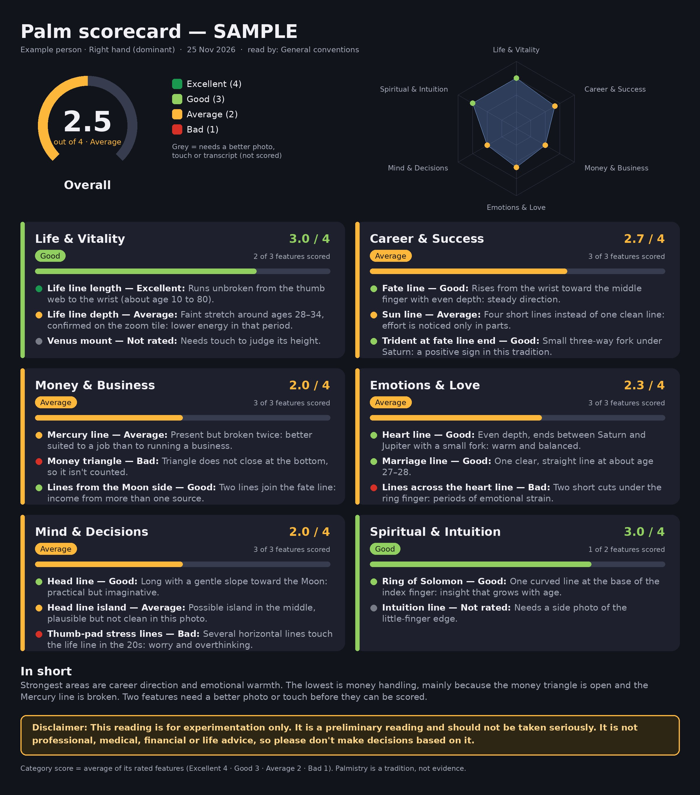

# Palm Reading Cross-check

A Claude plugin that reads palm photos in the palmistry tradition you choose, and checks palm readings you have received against what your photos actually show.

> **Disclaimer:** This plugin is for experimentation only. Its readings are preliminary and should not be taken seriously. They are not professional, medical, financial or life advice, so please don't make decisions based on them. Every reading the plugin produces carries this disclaimer.

> Palmistry is a cultural tradition with no scientific support. This plugin presents every reading as "in this tradition", never as fact, and it doesn't give medical advice. See a doctor about any real symptom, and a dermatologist about any new or changing mole.

## What it does

- **Reads your palms** from photos, using your own teacher's rules if you share them (notes, transcripts or teaching videos), or a set of general palmistry conventions if you don't.
- **Measures line depth.** It traces each major line, measures how dark and wide the crease is along its length, and flags faint stretches, possible gaps and islands with approximate ages. You then confirm them on zoomed close-ups.
- **Cross-checks readings.** It compares a palmist's or a report's claims with the photos, gives each claim a verdict, and separates astrology or date-of-birth claims from palm claims.
- **Matches teaching videos to their transcripts.** It lines up what a teacher draws on screen with what they say, so each rule can be traced to its source.
- **Produces four outputs:** a reading in chat, a rated spreadsheet with a score per hand, a colour-coded annotated palm image, and a life-area scorecard.

## Example scorecard

The scorecard rates six life areas: Life & Vitality, Career & Success, Money & Business, Emotions & Love, Mind & Decisions, and Spiritual & Intuition. Each card shows the area's score, the features behind it, and one line explaining each rating. The example below uses sample data, not a real reading.

## How to use it

Ask Claude something like "read my palm" and attach photos. For the best results:

- Send the original camera files, not compressed copies.
- Lay your hand flat, with side lighting and no flash.
- Add a side view of the little-finger edge for relationship lines.

## What it runs

The plugin is a single skill made of Markdown instructions; it contains no scripts or programs. When you share photos or videos, Claude analyses them in its own session with the tools it already has. That includes measuring how deep each palm line is and drawing the annotated image and scorecard. The plugin doesn't send your photos or data anywhere, doesn't fetch anything from the network, has no hooks or MCP servers, and doesn't change any settings.

## Privacy

Palm photos are personal. Share only your own hands, or those of people who have agreed to it.

## License

MIT
